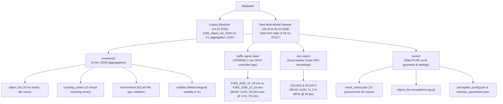
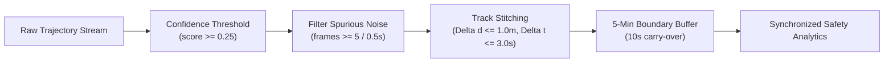

# Comprehensive Database & Project Guide
## Topic 4: Pedestrians and Cyclists at the Intersection – When and Where?
### *Fußgänger und Radfahrer an der Kreuzung – wann und wo?*

---

## 1. Executive Project Overview

* **Course & Scope**: Data Science Project – Traffic & Mobility Data Analytics.
* **Topic Title**: Topic 4 – Pedestrians and Cyclists at the Intersection (When and Where?).
* **Testbed Location**: Intersection **K305** (*Dr.-Willi-Reiland-Ring* & *Würzburger Straße*, Aschaffenburg, Bavaria, Germany).
* **Core Objective**: Analyze trajectories of Vulnerable Road Users (VRUs: pedestrians and cyclists) to uncover temporal volume profiles, spatial density heatmaps, typical crossing routes, and conflict zones where VRU paths overlap with motorized vehicle traffic.
* **Multi-Modal Datasets**:
  1. **Legacy Baseline Dataset (October 14, 2026)**: Initial 24-hour single-modality LiDAR object list (`database/k305_object_list_2026-10-14_aggregation_5min/`).
  2. **New Comprehensive Multi-Modal Dataset (October 28 & 29, 2026)**: High-fidelity, multi-sensor dataset (`database/Data from date of 28.10, 29.10./`) featuring enhanced ML tracking with substantially reduced flickering, official traffic signal controller timing logs (VRS5000), synchronized dual-angle Miovision Scout video recordings, virtual counting zones, environmental & weather sensors, and ground-truth LiDAR zone geometry.

---

## 2. Dataset Architecture & Specification

The project database contains two distinct generations of data captured at intersection K305.



---

### 2.1 New Multi-Modal Dataset (October 28 & 29, 2026)

Located at `database/Data from date of 28.10, 29.10./`, this dataset represents a major upgrade in sensor fusion, tracking stability, and ground-truth validation:

```
database/Data from date of 28.10, 29.10./
├── newsense/
│   ├── object_list/
│   │   ├── k305_object_list_2026-10-28_aggregation_5min/   (224 JSON files, 00:00–13:05 & 19:45–23:55)
│   │   └── k305_object_list_2026-10-29_aggregation_5min/   (288 JSON files, full 24h 00:00–23:59)
│   ├── counting_zones/
│   │   ├── k305_counting_zones_2026-10-28_aggregation_5min/ (224 JSON files)
│   │   └── k305_counting_zones_2026-10-29_aggregation_5min/ (288 JSON files)
│   ├── environment/
│   │   ├── k305_environment_2026-10-28_aggregation_5min/    (124 JSON files, 13:40–23:59)
│   │   └── k305_environment_2026-10-29_aggregation_5min/    (288 JSON files, full 24h 00:00–23:59)
│   └── visibility/
│       ├── k305_visibility_2026-10-28_aggregation_5min/     (234 JSON files)
│       └── k305_visibility_2026-10-29_aggregation_5min/     (288 JSON files, full 24h 00:00–23:59)
├── traffic signal data/
│   ├── K305_2026_10_28.xlsx                                 (25,200 rows @ 1 Hz, 06:00:00–13:00:00)
│   └── K305_2026_10_29.xlsx                                 (25,200 rows @ 1 Hz, 06:00:00–13:00:00)
├── mio vision/
│   └── miovision/K305/
│       ├── 2026_10_28/
│       │   ├── Standard_SCU3K2_2026-10-28_0600/             (7x 1-hour MP4 cuts 001–007 + logs)
│       │   └── Standard_SCU4YV_2026-10-28_0600/             (7x 1-hour MP4 cuts 001–007 + logs)
│       └── 2026_10_29/
│           ├── Standard_SCU3K2_2026-10-29_0600/             (7x 1-hour MP4 cuts 001–007 + logs)
│           └── Standard_SCU4YV_2026-10-29_0600/             (7x 1-hour MP4 cuts 001–007 + logs)
└── ouster/
    ├── 10_29_7_34_29/
    │   ├── 29_10_2026_07_34_29_raw.pcap                     (6.47 GB raw LiDAR packet stream)
    │   └── 10_29__7_34_29_configuration/settings/           (event_zones.json, perception_config.json, etc.)
    └── ouster/
        ├── 10_29__8_18_19/                                  (pcap capture + sensor configuration)
        ├── 10_29__9_04_14/                                  (configuration + sensor info)
        ├── 10_29__10_24_43/                                 (configuration + sensor info)
        └── object_list+occupations.log.2026-10-29_*.gz      (10 Hz streaming logs with real-time zone occupancy)
```

---

### 2.2 Subdirectory Specifications & Schemas

#### A. `newsense/object_list/` (Enhanced 10 Hz Trajectories)
* **Recording Rate**: 10 Hz ($\Delta t = 0.1\,\text{s}$ nominal, $\approx 3,000$ frames per 5-minute file).
* **Key Improvements over Legacy Data**:
  1. **Reduced Flickering & Fragmentation**: Perception uses Ouster Deep Learning ITS (`dl_its_settings`) with Kalman filtering (`unicycle` and `bicycle` kinematic models), substantially reducing ghost tracks and ID switches when road users wait.
  2. **Continuous Neural-Net Confidence Score**: `score` is a continuous probability $[0.20, 0.70+]$ (evaluated by the ML classifier), unlike the legacy static $1.0$.
* **Schema**:
```json
{
  "intersection_id": "k305",
  "topic": "object_list",
  "aggregation_minutes": 5,
  "aggregation_start_local": "2026-10-29T08:00:00+01:00",
  "frames": [
    {
      "frame_timestamp": {
        "seconds": 1793257200,
        "nanosec": 9739463
      },
      "timestamp_local": "2026-10-29T08:00:00.009739+01:00",
      "objects": [
        {
          "track_id": 12535,
          "class_name": "Cyclist",
          "score": 0.2335,
          "bounding_box": {
            "position": { "x": -18.61, "y": -27.98, "z": -0.96 },
            "yaw": 1.1609,
            "scale": { "x": 1.73, "y": 0.64, "z": 1.38 }
          },
          "velocity": { "x": 0.21, "y": 0.40 }
        }
      ]
    }
  ]
}
```

#### B. `newsense/counting_zones/` (23 Virtual Directional Counters)
* **Recording Rate**: 10 Hz (cumulative counts updated every frame).
* **Structure**: Each frame contains an array of 23 zones (`1` to `23`):
  * `zone_id` / `zone_name`: String identifier `"1"` to `"23"`.
  * `class_counts`: Dictionary mapping class name to 2-element directional array `[count_dir1, count_dir2]`.
  * `total_counts`: `[total_dir1, total_dir2]`.
  * `class_flows`: JSON string of current flow rate.
  * `event_counts`, `instance_count`, `zone_state`, `zone_type`: `"counting"`.
* **Corridor Assignment**:
  * **Motorized Vehicle Approaches**: Zones 1–5, 9–11 (record `Car`, `Van`, `Truck`, `Bus`).
  * **VRU Crossings & Corridors**: Zones 12–23 (record `Pedestrian` and `Cyclist` bidirectional counts).

#### C. `newsense/environment/` (Weather & Air Quality)
* **Recording Rate**: 1-minute averages (`avrg: 60`, 5 frames per 5-minute file).
* **Hardware Unit**: `ECoB` multi-sensor environmental station (`source_topic: 23921/data/main`).
* **Fields**:
  * `weather.t`: Air temperature in $^\circ\text{C}$ (e.g., $4.4^\circ\text{C}$).
  * `weather.p`: Atmospheric pressure in $\text{hPa}$ (e.g., $1013.7\,\text{hPa}$).
  * `weather.rh`: Relative humidity in $\%$ (e.g., $70.5\%$).
  * `pm.pm1`, `pm.pm2_5`, `pm.pm10`: Particulate matter in $\mu\text{g/m}^3$.
  * `gas.co2`: Carbon dioxide in $\text{ppm}$ (e.g., $1318\,\text{ppm}$).
  * `gas.no2`, `gas.so2`, `gas.o3`, `gas.co`: Trace gas concentrations.
  * `additional.gas_bvoc`: Volatile organic compounds.

#### D. `newsense/visibility/` (Atmospheric Visibility)
* **Recording Rate**: 1 Hz (~300 frames per 5-minute file).
* **Fields**:
  * `visibility_value`: Optical meteorological visibility distance (e.g., $2000.0$).
  * `unit`: Meters (`"m"`).

---

### 2.3 `traffic signal data/` (Official SPaT Controller Logs)

Provided by **Stadt Aschaffenburg – Tiefbauamt, Verkehrstechnik** from the central **VRS5000** traffic controller:
* **Files**: `K305_2026_10_28.xlsx` and `K305_2026_10_29.xlsx`.
* **Temporal Scope**: Exactly **06:00:00 to 13:00:00** (7 hours = 25,200 seconds, 25,200 data rows at exact 1 Hz).
* **Signal Phase Encoding**:
  | Code | German Term | Meaning | Traffic Status |
  | :---: | :--- | :--- | :--- |
  | **`R`** | Rot | Red | Stop / Don't walk |
  | **`G`** | Grün | Green | Go / Walk |
  | **`A`** | Gelb (Amber) | Amber / Yellow | Clearance / Prepare to stop |
  | **`S`** | Rot/Gelb | Red + Amber | Prepare to go (German standard) |
  | **`D`** | Dunkel | Dark / Off | Signal heads dark |
  | **`r`** | Rot blinkend | Flashing Red | Warning / Fault |
  | **`a`** | Gelb blinkend | Flashing Amber | Yield / Uncontrolled |
  | **`?`** | Unbekannt | Unknown | Status unreadable |

* **76 Column Mapping**:
  * **Timing**: `Datum` (Date), `Uhrzeit` (Time fraction of day), `Tx` (Cycle second counter 1..cycle length), `Timestamp`.
  * **Vehicle Signal Groups**: `K1`, `K2`, `K3`, `K4`, `K5`, `K6`, `K7`, `K10`, `K11` (Kraftfahrzeuge).
  * **Pedestrian Signal Groups**: `F1`, `F2`, `F3`, `F4`, `F5`, `F6`, `F7`, `F8`, `F9`, `F10`, `F12`, `F13`, `F14`, `F15` (Fußgänger).
  * **Cyclist Signal Group**: `R1` (Radfahrer).
  * **Detectors & Advance Loops**: `D1_1`, `D1_2`, `D2_1`, `D2_2`, `D3_1`, `D3_2`, `D3_3`, `D4_1`, `D4_2`, `VD4_3`, `D10_1`, `D10_2`, `D11`, `VD11_1`, `VD5_1`, `VD5_2`.
  * **Measurement Points**: `MP11`, `MP13`, `MP14`, `MP21` ... `MP114`.
  * **Pedestrian Push-Buttons**: `FT_RB1_1`, `FT1_2`, `FT_RB1_3`, `FT2_1`, `FT2_2` (Fußgängertaster demand requests).
  * **Supervisory Status**: `SP` (Signalprogramm ID: 1, 2), `PH` (Active Phase: 1–7), `UE` (Cycle counter), `VK_i_O` (Coordination OK).

---

### 2.4 `mio vision/` (Synchronized Ground-Truth Scout Cameras)

* **Cameras**: Two portable **Miovision Scout** video processing units deployed at intersection K305:
  1. `Standard_SCU3K2` (Hardware ID `00000a705ccf`)
  2. `Standard_SCU4YV` (Hardware ID `00000edde1ed`)
* **Recording Time**: Synchronized with the traffic signal data: **06:00:00 to 13:00:00** (7 hours).
* **Video Specifications**:
  * Codec: H.264 / AVC.
  * Resolution: $720 \times 480$ (NTSC Standard Definition).
  * Framerate: 29.97 fps (30000/1001).
  * Partitioning: 7 consecutive 1-hour video segments per camera (`.001.mp4` to `.007.mp4`).
* **Utility**: Provides optical ground-truth validation for verifying detected near-miss conflicts, right-turning vehicle blind spots, and signal compliance.

---

### 2.5 `ouster/` Ground-Truth Zones, Calibration & Settings

#### A. Official Ground-Truth Intersection Zones (`event_zones.json`)
The configuration directly defines the 14 spatial zones in the LiDAR coordinate frame ($[x, y]$ in meters, elevation $[0.0\,\text{m}, 3.0\,\text{m}]$):

| Zone Name | ID | Zone Function | Number of Vertices | Representative Polygon Vertices $(x, y)$ |
| :--- | :--- | :--- | :---: | :--- |
| **`Intersection`** | `1793198408032` | Inner intersection box | 4 | $(11.37, 4.61), (-11.13, -19.83), (-23.50, -10.45), (-0.82, 14.19)$ |
| **`CW-NB`** | `1793199235505` | Crosswalk Northbound | 4 | $(-1.97, 14.79), (-4.29, 17.15), (-27.67, -7.73), (-24.78, -10.52)$ |
| **`CW-SB`** | `1793199844813` | Crosswalk Southbound | 4 | $(16.23, 1.40), (13.43, 4.08), (-10.05, -22.73), (-5.95, -25.52)$ |
| **`CW-WB`** | `1793199978779` | Crosswalk Westbound | 4 | $(-9.85, -23.90), (-15.73, -29.87), (-32.14, -13.86), (-28.40, -9.69)$ |
| **`OCW-NB`** | `1793201238457` | Outer Crosswalk Northbound | 4 | $(-11.36, 17.55), (-38.87, -12.74), (-77.72, 19.92), (-54.65, 51.92)$ |
| **`OCW-WB`** | `1793202317826` | Outer Crosswalk Westbound | 4 | $(-17.22, -34.56), (-54.81, -77.82), (-67.90, -67.58), (-33.46, -20.90)$ |
| **`Bike-EB`** | `1793201833098` | Dedicated Bike Lane Eastbound | 4 | $(40.31, 40.13), (29.38, 21.11), (27.24, 21.67), (38.78, 41.67)$ |
| **`VC-EB`** | `1793198910212` | Vehicle Corridor Eastbound | 4 | $(22.23, 16.61), (13.43, 6.15), (0.92, 17.00), (8.63, 26.35)$ |
| **`VC-WB`** | `1793200055013` | Vehicle Corridor Westbound | 4 | $(-16.32, -30.21), (-33.68, -51.31), (-45.92, -36.10), (-31.57, -15.51)$ |
| **`VC-NB`** | `1793199761920` | Vehicle Corridor Northbound | 4 | $(-11.59, 16.72), (-30.94, -5.41), (-44.37, 4.98), (-25.29, 28.05)$ |
| **`Q-EB1`** | `1793202159132` | Queue Eastbound Lane 1 | 4 | $(26.37, 33.25), (25.16, 34.56), (4.82, 12.50), (7.67, 9.95)$ |
| **`Q-EB2`** | `1793200284049` | Queue Eastbound Lane 2 | 4 | $(3.06, 15.07), (1.53, 16.92), (23.29, 41.01), (27.32, 37.90)$ |
| **`Q-SB`** | `1793202436536` | Queue Southbound | 4 | $(66.08, -29.32), (61.71, -36.04), (16.33, -10.31), (21.08, -3.43)$ |
| **`PET`** | `1793199114776` | Post-Encroachment Conflict Zone | 12 | 12-vertex boundary encompassing all vehicle-VRU intersection conflict space |

#### B. Multi-LiDAR Extrinsics (`extrinsic_parameters.json`)
Calibrates 4 roadside LiDAR sensor units relative to the intersection `world` frame:
* Sensor `122051000769`: Reference base $(0.0, 0.0, 0.0)$.
* Sensor `122307001715`: Elevation offset $z = +1.037\,\text{m}$.
* Sensor `992425000328`: Coplanar $(0.0, 0.0, 0.0)$.
* Sensor `992519001027`: Spatial mount at $(-18.00\,\text{m}, +3.50\,\text{m}, +4.55\,\text{m})$ overlooking Dr.-Willi-Reiland-Ring.

---

### 2.6 Legacy Baseline Dataset (October 14, 2026)

Located at `database/k305_object_list_2026-10-14_aggregation_5min/`:
* **File Count**: 288 JSON files covering a complete 24-hour cycle (`2026-10-14 00:00:00` to `23:59:59` CEST).
* **Interval**: Each file aggregates exactly 5 minutes of data.
* **Recording Frequency**: Recorded at **10 Hz** ($\Delta t = 0.1\,\text{s}$).
* **Detector Score**: Static $1.0$ across all detections.
* **Artifacts**: Exhibits tracker flickering and fragmentation when VRUs wait at signals, requiring trajectory stitching and spurious track filtering.

---

## 3. Detected Object Classes & Empirical Statistics

Both legacy and new datasets classify road users into 7 consistent categories:

| Class Name | Category | Share (Legacy Baseline) | Typical Dimensions ($L \times W \times H$) | Mean Speed | Peak Observed Speed |
| :--- | :--- | :--- | :--- | :--- | :--- |
| **`Pedestrian`** | **VRU** | **17.51%** | $0.75 \times 0.65 \times 1.75\,\text{m}$ | $0.58\,\text{m/s}$ ($2.1\,\text{km/h}$) | $2.78\,\text{m/s}$ ($10.0\,\text{km/h}$) |
| **`Cyclist`** | **VRU** | **3.10%** | $1.90 \times 0.70 \times 1.75\,\text{m}$ | $1.41\,\text{m/s}$ ($5.1\,\text{km/h}$) | $6.38\,\text{m/s}$ ($23.0\,\text{km/h}$) |
| **`Car`** | Motorized | **71.24%** | $4.20 \times 1.80 \times 1.50\,\text{m}$ | $2.13\,\text{m/s}$ ($7.7\,\text{km/h}$) | $13.65\,\text{m/s}$ ($49.1\,\text{km/h}$) |
| **`Van`** | Motorized | **4.90%** | $5.30 \times 2.05 \times 2.10\,\text{m}$ | $2.25\,\text{m/s}$ ($8.1\,\text{km/h}$) | $13.20\,\text{m/s}$ ($47.5\,\text{km/h}$) |
| **`Truck`** | Motorized | **2.47%** | $8.50 \times 2.50 \times 3.20\,\text{m}$ | $1.85\,\text{m/s}$ ($6.7\,\text{km/h}$) | $11.50\,\text{m/s}$ ($41.4\,\text{km/h}$) |
| **`Motorcycle`** | Motorized | **0.56%** | $2.10 \times 0.80 \times 1.40\,\text{m}$ | $2.80\,\text{m/s}$ ($10.1\,\text{km/h}$) | $12.80\,\text{m/s}$ ($46.1\,\text{km/h}$) |
| **`Bus`** | Motorized | **0.22%** | $12.0 \times 2.55 \times 3.30\,\text{m}$ | $1.70\,\text{m/s}$ ($6.1\,\text{km/h}$) | $10.20\,\text{m/s}$ ($36.7\,\text{km/h}$) |

> [!NOTE]
> In the new dataset (`2026-10-28` and `2026-10-29`), detections carry real-valued ML confidence scores `score` $\in [0.20, 0.70+]$ from the deep-learning classifier. In peak morning intervals (e.g., 08:00–08:05), Pedestrian and Cyclist detection counts exceed 32,000 instances per 5-minute file.

---

## 4. Data Cleanliness Assessment & Cleaning Protocols

### 4.1 Comparison: Legacy vs. New Dataset

| Dimension | Legacy Dataset (14.10.2026) | New Dataset (28.10 & 29.10.2026) |
| :--- | :--- | :--- |
| **Tracking Model** | Basic geometric clustering | Deep Learning ITS (`dl_its_settings`) Kalman tracker |
| **Flickering & ID Drops** | High (54k spurious tracks $<0.5\,\text{s}$; ID resets at red lights) | **Substantially reduced**; persistent track retention |
| **Confidence Score** | Constant $1.0$ | Continuous ML probability ($0.20 \le \text{score} \le 0.70+$) |
| **Ground-Truth Zones** | Inferred from trajectory clustering | **Official 14 polygonal zones** (`event_zones.json`) |
| **Signal Timing (SPaT)** | None (estimated from vehicle stops) | **Official 1 Hz controller logs** (`traffic signal data/`) |
| **Video Ground Truth** | None | **Dual Miovision Scout cameras** (`mio vision/`) |
| **Temporal Coverage** | Full 24 hours (288 files) | 29.10: Full 24h (288 files); 28.10: 224 files (afternoon gap) |

### 4.2 Cleaning Pipeline Rules



1. **Filtering Spurious Short Tracks**: Exclude any trajectory with $\text{total frames} < 5$ ($< 0.5\,\text{s}$).
2. **Confidence Thresholding (New Data)**: Use `score >= 0.25` to eliminate low-confidence border artifacts.
3. **Stationary Track Stitching**: If Track $B$ initiates within $\Delta d \le 1.0\,\text{m}$ and $\Delta t \le 3.0\,\text{s}$ of Track $A$'s termination, stitch them into a single continuous entity.
4. **5-Minute Boundary Stitching**: Handled via rolling 10-second carry-over buffer (`BOUNDARY_BUFFER_SEC = 10.0`) in `near_miss_analysis.py`.
5. **Temporal Continuity Notes**:
   * `2026-10-29`: Complete 24-hour sequence (288 files, 00:00 to 23:59).
   * `2026-10-28`: Continuous morning (00:00 to 13:05, 157 files) and night (19:45 to 23:59, 50 files); maintenance gap from 13:10 to 19:44 (64 files). The morning period (06:00 to 13:00) is 100% complete across all modalities.

---

## 5. The "Duration vs. Count" Methodology

### 5.1 Formulation of Presence Duration / Dwell Time
Summing raw detections or raw IDs produces systematic bias (waiting pedestrians generate 600 frames/min vs. 100 frames/min for crossing pedestrians; tracker dropouts artificially inflate unique ID counts). The rigorous metric is **Spatial Occupancy / Dwell Time**:

#### A. Zone-Based Dwell Time
For object $i$ observed at frames $t \in \{1, \dots, N_i\}$ with 2D position $\mathbf{p}_i(t) = (x_i(t), y_i(t))$ in zone $Z_k$:

$$\text{Dwell Time}_{i, Z_k} = \sum_{t=1}^{N_i} \mathbb{I}\Big(\mathbf{p}_i(t) \in Z_k\Big) \cdot \Delta t \quad (\text{seconds})$$

Where $\Delta t = 0.1\,\text{s}$ and $\mathbb{I}(\cdot)$ is the indicator function ($1$ if inside the polygon, $0$ otherwise).

#### B. Cumulative Exposure
$$\text{Occupancy}(C, Z_k) = \sum_{i \in C} \text{Dwell Time}_{i, Z_k} \quad (\text{person-seconds or vehicle-seconds})$$

#### C. Spatial Dwell-Time Grid (Heatmaps)
Discretized into uniform grid cells $g_{u,v}$ of size $0.5\,\text{m} \times 0.5\,\text{m}$:

$$D(u, v) = \frac{1}{\text{Area}(g_{u,v})} \sum_{i} \sum_{t} \mathbb{I}\Big(\mathbf{p}_i(t) \in g_{u,v}\Big) \cdot \Delta t \quad \left(\frac{\text{seconds}}{\text{m}^2}\right)$$

---

## 6. Core Deliverables & Metrics for Topic 4

```
+-----------------------------------------------------------------------------------------------+
| Topic 4 Deliverables Matrix                                                                   |
+-------------------+-----------------------------------------+---------------------------------+
| Deliverable       | Required Output                         | Data Source & Format            |
+-------------------+-----------------------------------------+---------------------------------+
| Temporal Profiles | 15-Minute Volume & Duration Curves      | newsense/object_list &          |
|                   | (Pedestrians & Cyclists by corridor)    | counting_zones (12–23)          |
+-------------------+-----------------------------------------+---------------------------------+
| Spatial Density   | 2D Dwell-Time Heatmaps                  | 10 Hz coordinates mapped to     |
|                   | (Pedestrians, Cyclists, Motorized)      | event_zones.json polygons       |
+-------------------+-----------------------------------------+---------------------------------+
| Typical VRU Paths | Clustered Crossing Trajectories         | DBSCAN / LineString paths on    |
|                   | (CW-NB, CW-SB, CW-WB, Bike-EB)          | ground-truth crosswalk channels |
+-------------------+-----------------------------------------+---------------------------------+
| Conflict Overlap  | Surrogate Safety (TTC < 1.5s, PET)      | near_miss_analysis.py +         |
|                   | correlated with Signal States (R/G)     | traffic signal data/ (VRS5000)  |
+-------------------+-----------------------------------------+---------------------------------+
| Video Validation  | Visual near-miss confirmation           | mio vision/ Scout MP4 cameras   |
+-------------------+-----------------------------------------+---------------------------------+
| Weather Impact    | VRU volume vs. temperature & rain       | newsense/environment &          |
|                   |                                         | newsense/visibility             |
+-------------------+-----------------------------------------+---------------------------------+
```

---

## 7. Near-Miss Pipeline & Animation Architecture

The project codebase provides full end-to-end tooling:

1. **Near-Miss Engine (`near_miss_analysis.py` / `near_miss_analysis.ipynb`)**:
   - Vectorized kinematic Time-To-Collision (Hayward 1972) via NumPy broadcasting ($O(N^2)$ checks in $<1\,\text{ms}$).
   - $2\,\text{m} \times 2\,\text{m}$ grid spatial accumulator for Post-Encroachment Time (Allen 1978).
   - Event consolidation ($0.25\,\text{s}$ temporal gap clustering).
2. **Extended Results Visualizer (`analyze_full_day_results.py`)**:
   - Post-processes full-day event CSVs without rerunning raw detection checks.
   - Generates publication figures: `spatial_hotspots.png`, `hourly_interactions.png`, and `ttc_by_interaction_type.png`.
3. **Peak Traffic Search & 2D Simulation (`find_peak_traffic.py` / `data_video.py`)**:
   - Evaluates files to identify peak traffic intervals.
   - Generates animated 2D LiDAR trajectory simulations (`output/peak_traffic_0740.gif`).

---

## 8. Recommended Technical Stack & Tools

* **Core Data Handling**: `Python 3.10+`, `pandas`, `numpy`.
* **High-Throughput Processing**: `polars` or `duckdb`.
* **Spatial Geometry & Polygons**: `shapely` (`Polygon`, `Point`, `MultiLineString`) and `geopandas` (using vertices from `event_zones.json`).
* **Signal Data Ingestion**: `openpyxl` / `zipfile` for `K305_2026_10_*.xlsx`.
* **Video Verification**: `opencv-python` / `ffmpeg` for `mio vision/*.mp4`.
* **Density & Heatmaps**: `scipy.stats.gaussian_kde`, `seaborn`, `matplotlib`.
* **Trajectory Clustering**: `scikit-learn` (`DBSCAN` / `HDBSCAN`).

---

## 9. Summary for Meetings with Professors & Supervisors

### 30-Second Elevator Pitch
> *"With the new dataset from October 28 and 29, our Topic 4 pipeline has evolved from an exploratory LiDAR analysis into a fully calibrated multi-sensor platform. The new LiDAR data features an improved deep-learning ITS tracker with substantially reduced flickering and continuous ML confidence scores. Most importantly, the dataset provides the official 14 ground-truth intersection polygons (`event_zones.json`), 1 Hz traffic controller signal logs (`traffic signal data`), synchronized dual-camera Miovision Scout video recordings, 23 virtual counting zones, and environmental weather data. This allows us to correlate pedestrian and cyclist near-miss conflicts directly with active signal phases (e.g. crossing on red vs. green) and validate conflict events against optical video footage."*

### Key Clarifications Resolved by the New Dataset
1. **Intersection Map & Crosswalk Geometry**: Resolved by `ouster/.../settings/event_zones.json`, providing official 3D polygonal boundaries for all crosswalks (`CW-NB`, `CW-SB`, `CW-WB`), bike lanes (`Bike-EB`), corridors, and queues.
2. **Signal Phasing & Timing**: Resolved by `traffic signal data/K305_2026_10_*.xlsx`, giving exact 1 Hz signal indications for all vehicle groups (`K1`..`K11`), pedestrian groups (`F1`..`F15`), and cyclist signal `R1`.
3. **Visual Ground-Truth**: Resolved by `mio vision/`, providing two synchronized camera perspectives covering 06:00 to 13:00.
