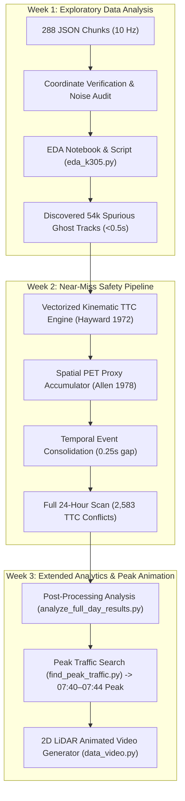

# Topic 4: Pedestrians and Cyclists at the Intersection (When and Where?)
### *Fußgänger und Radfahrer an der Kreuzung – wann und wo?*

[](https://www.python.org/downloads/)
[](LICENSE)
[-orange.svg)](#dataset-specifications)
[](#core-methodology--mathematics)

A high-throughput Data Science and Traffic Safety Engineering research pipeline for detecting, quantifying, and mapping near-miss traffic conflicts between motorized vehicles and Vulnerable Road Users (VRUs: pedestrians and cyclists) using roadside infrastructure LiDAR data.

**Dashboard:** an interactive Streamlit dashboard for the 29 October 2026 data (when and where, conflicts, signals,
NSE vs Ouster, replay with video). Follow the [dashboard run tutorial](docs/RUN_DASHBOARD.md) for installation,
data generation, and troubleshooting; [dashboard/README.md](dashboard/README.md) describes the pages and data.

---

## 📍 Testbed & Dataset Specifications

* **Location**: Intersection **K305** (*Dr.-Willi-Reiland-Ring* & *Würzburger Straße*, Aschaffenburg, Bavaria, Germany).
* **Observation Date**: Wednesday, October 14, 2026 (`00:00:00` to `23:59:59` CEST).
* **Sensor**: Roadside Infrastructure LiDAR recording at **10 Hz** ($\Delta t = 0.1\,\text{s}$).
* **Temporal Partitioning**: 288 consecutive 5-minute JSON chunks.
* **Dataset Scope**:
  * **860,338** analyzed frames.
  * **11,493,486** raw object detections.
  * **178,854** tracked traffic participants across 7 classes:
    * Motorized: Cars (96,730), Vans (12,907), Trucks (6,695), Buses (1,590), Motorcycles (1,432).
    * Vulnerable Road Users (VRUs): Pedestrians (46,710), Cyclists (12,770) — representing **> 33% of all road users**.

---

## 🚀 Project Evolution & Milestones



* **Week 1 (Exploratory Data Analysis)**:
  * Ingested 5-minute JSON chunks, decoded bounding-box orientations, scales, and velocities.
  * Identified sensor jitter, tracker duplicate rows, and high volumes of transient ghost tracks ($< 0.5\,\text{s}$).
* **Week 2 (Surrogate Safety Analysis - TTC & PET)**:
  * Implemented **Time-To-Collision (TTC)** using pairwise quadratic kinematic equations vectorized with NumPy array broadcasting ($O(N^2)$ checks in $<1\,\text{ms}$).
  * Built a **Post-Encroachment Time (PET)** $2\,\text{m} \times 2\,\text{m}$ grid spatial accumulator.
  * Developed **Event Consolidation** algorithm to cluster $10\,\text{Hz}$ frame alarms into distinct physical conflict episodes.
  * Executed the complete 24-hour run across all 860,338 frames.
* **Week 3 (Extended Analysis & Peak Simulation)**:
  * Created `analyze_full_day_results.py` to produce publication-grade statistical summaries and visualizations without rerunning the heavy detection engine.
  * Developed `find_peak_traffic.py` to evaluate traffic density across all 288 chunks, identifying **07:40 to 07:44** as the absolute daily peak.
  * Built `data_video.py` to generate 2D animated LiDAR trajectory simulations (`output/peak_traffic_0740.gif`).

---

## 🔬 Core Methodology & Mathematics

In traffic safety engineering, fatal and severe crashes are statistically rare events. Relying on retrospective crash records to improve dangerous intersections is ethically unacceptable and statistically inefficient. Under **Heinrich's Safety Triangle**, near-miss traffic conflicts share the exact same causal failure mechanisms (e.g., driver inattention, blind spots during right turns, failure to yield) while occurring hundreds to thousands of times more frequently.

```
       ▲  [ 1 Fatal Crash ]
      ╱ ╲
     ╱   ╲  [ 30 Minor Collisions ]
    ╱     ╲
   ╱       ╲  [ 2,583 Critical TTC Near-Misses (< 1.5s) ]
  ╱         ╲
 ╱           ╲  [ 22,192 Spatial PET Encroachments (< 1.5s) ]
╱─────────────╲  [ Millions of Safe Trajectory Passages ]
```

### 1. Kinematic Time-To-Collision (TTC) — Hayward (1972)
TTC predicts the time remaining before two moving bodies collide assuming constant velocity vectors.

For Object 1 ($\vec{r}_1, \vec{v}_1$) and Object 2 ($\vec{r}_2, \vec{v}_2$) with protective circular radii $r_1, r_2$:
* Relative position: $\Delta \vec{r} = \vec{r}_2 - \vec{r}_1$
* Closing velocity: $\Delta \vec{v} = \vec{v}_1 - \vec{v}_2$
* Protective boundary contact: $\|\Delta \vec{r} - \Delta \vec{v} \cdot t\|^2 = (r_1 + r_2)^2$

This expands to the quadratic equation:
$$a \cdot t^2 + b \cdot t + c = 0$$

Where:
* $a = \|\Delta \vec{v}\|^2 = \Delta v_x^2 + \Delta v_y^2$ *(Relative speed squared)*
* $b = 2(\Delta x \Delta v_x + \Delta y \Delta v_y)$ *(Closing convergence rate)*
* $c = (\Delta x^2 + \Delta y^2) - (r_1 + r_2)^2$ *(Surface-to-surface distance squared)*

**Vectorized Solving**:
With up to 40 road users per frame (780 pairs per frame, 7,800 checks/sec), NumPy broadcasting solves all pairwise quadratic roots simultaneously in compiled C-speed.
* Near-miss threshold: **$\text{TTC} < 1.5\,\text{seconds}$** (German and international standard; *Minderhoud & Bovy, 2001*).

### 2. Post-Encroachment Time (PET) — Allen et al. (1978)
While TTC is predictive, PET is observational:
$$\text{PET} = t_{\text{enter, 2}} - t_{\text{exit, 1}}$$
Implemented as a streaming $2\,\text{m} \times 2\,\text{m}$ grid-cell proxy (`PETAccumulator`) that monitors sequential passage clearance gaps between vehicles and VRUs.

### 3. Temporal Event Consolidation
At 10 Hz, a single 1.2-second conflict generates 12 consecutive alerts. Our consolidation algorithm clusters frames belonging to the same road-user pair within a **$0.25\,\text{s}$ gap window**, compressing 12,656 raw frames into **2,583 distinct physical conflict episodes** and recording the minimum TTC, duration, and spatial coordinates.

### 4. Chunk-Boundary Stitching & Continuity Buffer
When analyzing 288 consecutive 5-minute JSON chunks in a streaming pipeline, interactions and trajectories crossing file seams previously suffered from boundary truncation, filter edge distortions, and split events.
* **Mechanism**: A 10.0-second carry-over buffer (`BOUNDARY_BUFFER_SEC = 10.0`, ~100 frames) extracts raw observations from the tail of Chunk $N$ and passes them as a prefix into Chunk $N+1$.
* **Smoothing & Deduplication Logic**: Track deduplication and 5-frame rolling-mean velocity smoothing run across the stitched array, rescuing short boundary-crossing tracks ($<5$ frames in Chunk $N+1$). After smoothing, buffered tail frames ($t \le t_{\text{tail, max}}$) are stripped out so they are never double-counted in dataset frame counts or summary statistics.
* **Seam Integrity & Safety**: Filename timestamp parsing (`_chunks_are_consecutive`) ensures stitching occurs only between adjacent files. Spanning interactions are automatically unified by `consolidate_ttc_events()` into a single physical episode with exact global minimum TTC.

---

## 📊 Full-Day Empirical Findings (October 14, 2026)

### 1. Headline Statistics
| Metric | Value | Description |
| :--- | :---: | :--- |
| **Analyzed Frames** | **860,338** | Complete 24h continuous data |
| **Total Detections** | **11,493,486** | Raw bounding box instances |
| **Noise Tracks Filtered** | **54,113** | Transient sensor noise tracks ($<0.5\,\text{s}$) |
| **Consolidated TTC Events** | **2,583** | Distinct conflicts with $\text{TTC} < 1.5\,\text{s}$ |
| **Median Min TTC** | **0.57 s** | Critical proximity reached during conflicts |
| **Mean Min TTC** | **0.64 s** | Average minimum TTC across all events |
| **PET Proxy Records** | **22,192** | Spatial co-occupancy gaps $< 1.5\,\text{s}$ (Median: 1.10s) |

### 2. "Who" is in Danger? (Conflict Breakdown by Mode)
* **Pedestrians**: Involved in **61.4%** of all near-misses (1,587 events).
* **Cyclists**: Involved in **38.6%** of all near-misses (996 events).

| Interaction Pair | Consolidated Events | % of Total | Danger / Risk Context |
| :--- | :---: | :---: | :--- |
| **Car vs. Pedestrian** | **1,024** | **39.6%** | Crosswalk turning conflicts |
| **Cyclist vs. Car** | **760** | **29.4%** | Bike lane / right-turn vehicle lane conflict |
| **Truck vs. Pedestrian** | **212** | **8.2%** | Severe blind-spot & wide sweep radius |
| **Bus vs. Pedestrian** | **175** | **6.8%** | Transit stop approach & intersection turns |
| **Van vs. Pedestrian** | **145** | **5.6%** | Delivery vehicle maneuvers |
| **Bus vs. Cyclist** | **69** | **2.7%** | Shared curb lane overtaking |
| **Truck vs. Cyclist** | **65** | **2.5%** | Classic right-hook blind-spot risk |
| **Van vs. Cyclist** | **49** | **1.9%** | Door zone & lane changes |
| **Motorcycles vs. VRUs** | **54** | **2.1%** | High speed differential encounters |

> [!IMPORTANT]
> **Heavy Vehicle Risk**: Trucks and Buses represent less than 5% of intersection traffic volume, yet they account for **20.2% of all near-miss events (521 events)**. This provides statistical proof of severe turning blind-spot hazards at K305.

### 3. "When" Do Conflicts Happen? (Tri-Modal Temporal Peaks)
Near-misses cluster sharply around daily human routines:
1. **Morning Commute (07:00 – 08:00)**: **300 events** *(Work & school rush)*.
2. **Midday School Dismissal (13:00 – 14:00)**: **295 events** *(Lunch travel & school end)*.
3. **Evening Commute (16:00 – 17:00)**: **286 events** *(Work return commute)*.
* Peak traffic interval of the day: **07:40 to 07:44** (`k305_object_list_2026-10-14_07-40_to_07-44.json`).

---

## 📁 Repository Structure

```
.
├── near_miss_analysis.py             # Core Week 2 pipeline (vectorized TTC, PET, consolidation)
├── near_miss_analysis.ipynb          # Interactive research notebook (quick sample & full run)
├── analyze_full_day_results.py       # Week 3 extended post-processing & publication visualizer
├── find_peak_traffic.py              # Scans 288 files to rank intervals by vehicle/VRU density
├── data_video.py                     # Generates 2D animated LiDAR simulation videos / GIFs
├── eda_k305.py                       # Week 1 exploratory data analysis pipeline
├── eda_k305.ipynb                    # Week 1 exploratory Jupyter notebook
├── requirements.txt                  # Python package dependencies
├── DATABASE_AND_PROJECT_GUIDE.md     # In-depth database reference & geometry guide
├── RUN_NEAR_MISS_ANALYSIS.md         # Operational execution guide for near_miss_analysis
├── WEEK_3_PROGRESS_REPORT.md         # Formal Week 3 progress report
├── week 2/
│   ├── WEEK2_MEETING_SCRIPT.md       # Spoken presentation script & Q&A defense cheat sheet
│   └── WEEK2_NEAR_MISS_PROJECT_AND_MEETING_GUIDE.md # Week 2 theoretical & empirical handbook
├── week_1/
│   ├── WEEK1_MEETING_SCRIPT.md       # Week 1 presentation script
│   └── WEEK1_PROJECT_AND_MEETING_GUIDE.md # Week 1 documentation
└── output/
    ├── full_day_20261026_204014_631230/ # 24-hour run output (2,583 TTC events, run_report.json)
    ├── extended_analysis/            # Week 3 figures (hotspots, hourly curves, TTC boxplots)
    └── peak_traffic_0740.gif         # 2D animated simulation of the 07:40 peak traffic window
```

---

## 🛠️ Installation & Usage

### 1. Environment Setup
```bash
# Clone the repository
git clone https://github.com/arman-nqz/pedestrian-and-cyclists-at-the-intersection-data-science-project.git
cd pedestrian-and-cyclists-at-the-intersection-data-science-project

# Create and activate virtual environment
python3 -m venv .venv
source .venv/bin/activate  # On Windows: .venv\Scripts\activate

# Install dependencies
pip install -r requirements.txt
```

### 2. Verify Mathematical Kinematics (Self-Test)
```bash
python near_miss_analysis.py --self-test
```
*Validates approaching, separating, parallel, overlapping, and boundary collision conditions against exact analytical physics.*

### 3. Run Near-Miss Detection Pipeline
```bash
# Quick 15-minute sample (08:00 to 08:14)
python near_miss_analysis.py

# Full 24-hour scan (288 files, 860k frames)
python near_miss_analysis.py --all

# Full 24-hour fast scan (skip chart generation)
python near_miss_analysis.py --all --no-plots
```

### 4. Run Week 3 Extended Analysis
```bash
# Post-processes existing 24-hour event CSVs (runs in seconds)
python analyze_full_day_results.py
```
*Outputs: `spatial_hotspots.png`, `hourly_interactions.png`, `ttc_by_interaction_type.png`, `findings.md`.*

### 5. Find Daily Peak Interval & Generate Traffic Animation
```bash
# Rank all 288 files by traffic volume and VRU count
python find_peak_traffic.py

# Generate 2D LiDAR animation of peak traffic (outputs GIF/MP4)
python data_video.py --input database/k305_object_list_2026-10-14_aggregation_5min/k305_object_list_2026-10-14_07-40_to_07-44.json --format gif --max-frames 600
```

---

## ⚠️ Known Methodological Limitations & Future Roadmap

1. **Constant Velocity Assumption**: TTC assumes straight-line unaccelerated movement. A driver decelerating from $30\,\text{km/h}$ to yield at a crosswalk can trigger a false alert before stopping safely.  
   *Planned*: Constant Acceleration / Deceleration to Clear (DTC) modeling.
2. **Circular Bounding Envelopes**: Circumscribed circles ($r = 0.5\sqrt{L^2 + W^2}$) give a 12m bus a 12.3m circle, causing artificial overlaps with cyclists in adjacent lanes.  
   *Planned*: 3D Oriented Bounding Box (OBB) separating axis polygon collision checks.
3. **2m Grid Discretization Artifacts**: The PET proxy recorded 22k events because pedestrians waiting at the curb touch the same 2m cell as passing vehicles.  
   *Planned*: Polygonal crosswalk zones and sidewalk curb offset buffers.
4. **Traffic Light (SPaT) Signal Data**: Without signal timing logs, the pipeline cannot distinguish permitted green turns from illegal red-light violations.  
   *Planned*: Ingest SPaT controller logs or infer signal phases from queue stop-and-go patterns.
5. **5-Minute Chunk Boundary Seams**:  
   *Status*: **Resolved ✅** — Implemented a 10.0-second rolling carry-over buffer in `near_miss_analysis.py` (`preprocess_chunk` carry-over & strip pattern) ensuring unbroken rolling-mean smoothing, short-track rescue, and seam-spanning TTC/PET event consolidation without frame double-counting.

---

## 👥 Contributors & Academic Context

* **Project**: Topic 4 — Pedestrians and Cyclists at the Intersection (When and Where?)
* **Institution**: Technical University of Applied Sciences Aschaffenburg (TH Aschaffenburg)
* **Dataset**: Intersection K305 Roadside LiDAR Research Infrastructure
* **Authors**: Arman & Hammad Ahmad
