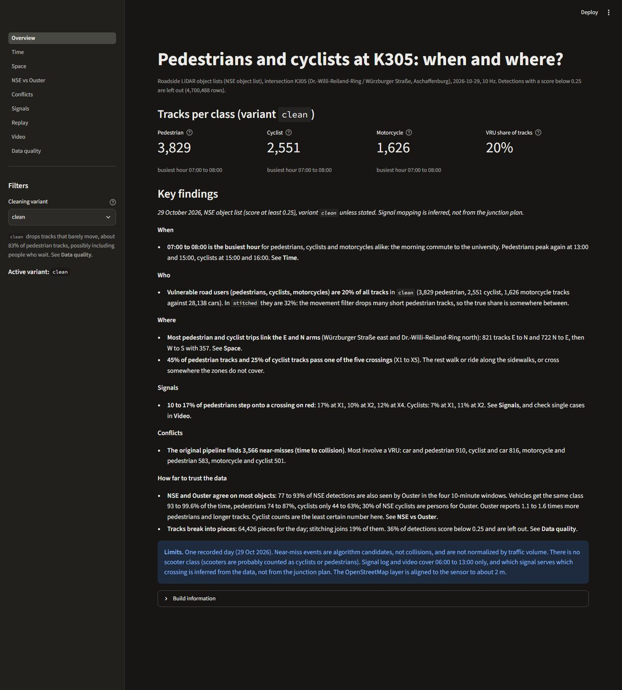
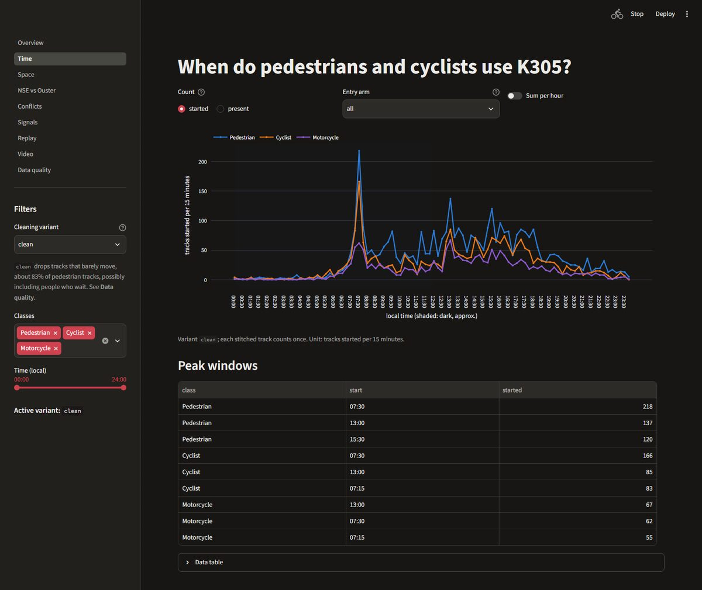
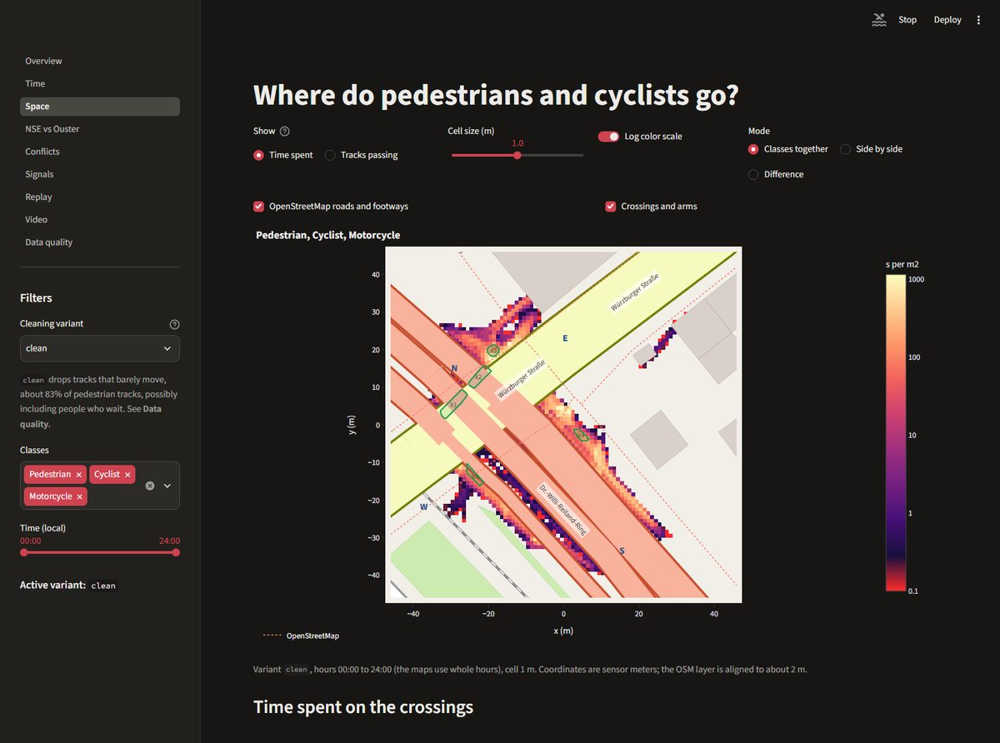
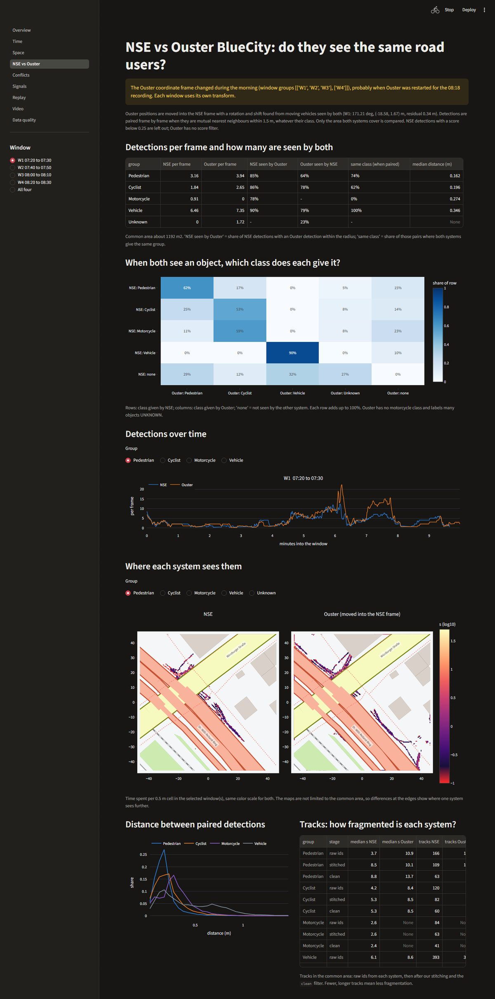
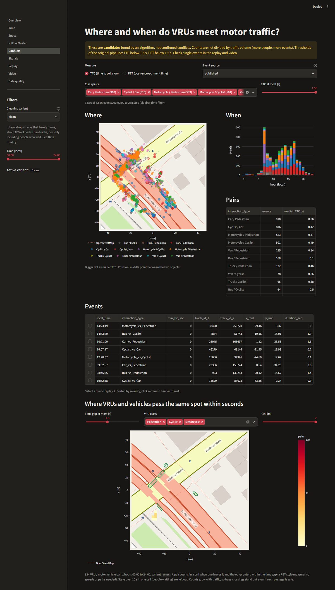
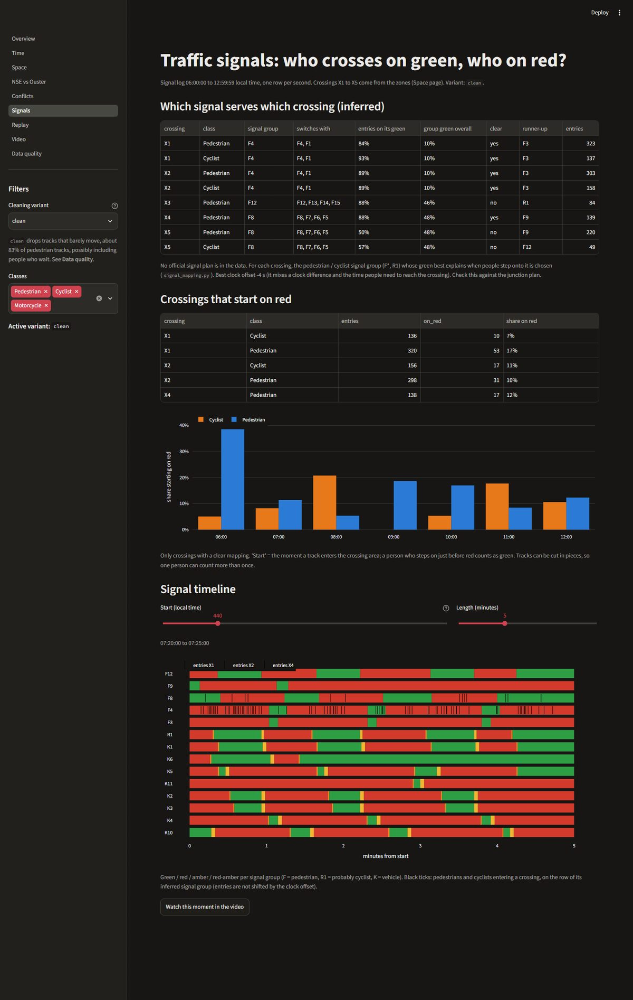
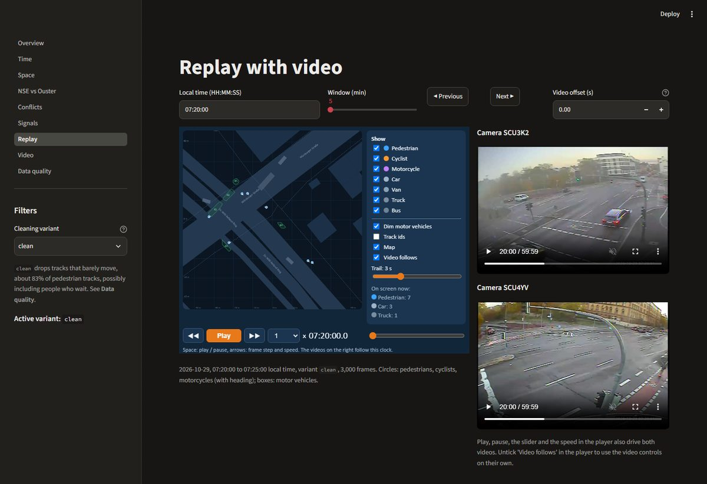
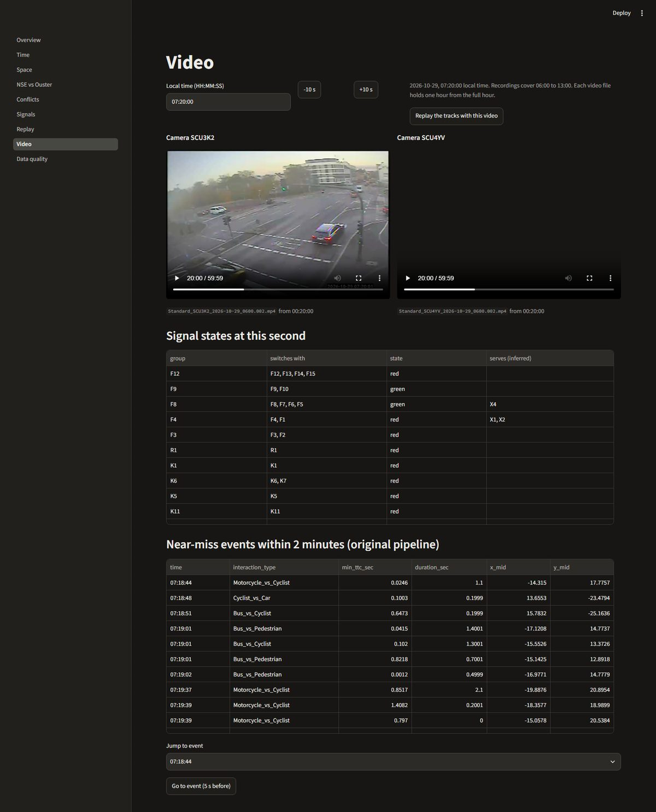
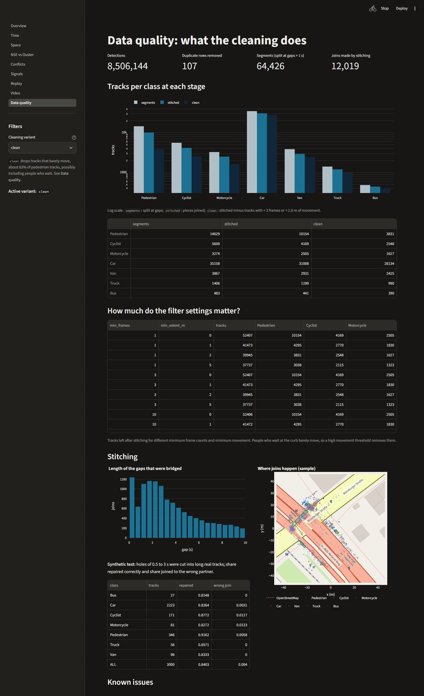

# K305 VRU dashboard

An interactive Streamlit dashboard for Topic 4, **"Pedestrians and cyclists at the intersection K305: when and where?"**
It shows when and where pedestrians, cyclists and motorcycles (vulnerable road users, VRUs) use the junction of
Dr.-Willi-Reiland-Ring and Würzburger Straße in Aschaffenburg, and where they meet motor traffic. Every number can be
checked against the recording: replay the tracks on the map with both camera videos running alongside.

Data: **29 October 2026** (CET, UTC+1). NSE LiDAR object list for the whole day, plus Ouster BlueCity LiDAR
(about 07:12 to 08:35), the VRS5000 traffic signal log and two Miovision cameras (06:00 to 13:00).

## Run it

```bash
pip install -r requirements.txt
python build_dashboard_data.py --data-dir "database/Data from date of 28.10, 29.10./newsense/object_list/k305_object_list_2026-10-29_aggregation_5min"
streamlit run dashboard/Overview.py
```

Then open http://localhost:8501. Tested with Python 3.13 and Streamlit 1.67. The dashboard reads prebuilt files from
`dashboard/data/` (not in git, see [Build the data](#build-the-data)); a page whose files are missing says which
command to run. For a step-by-step setup guide and troubleshooting, see [docs/RUN_DASHBOARD.md](../docs/RUN_DASHBOARD.md).

After pulling code changes, restart Streamlit: it reloads pages on save, but not the modules in `dashboard/lib/`.

## Pages

| Page | What it answers |
|---|---|
| **Overview** | Track counts per class, the key findings (`content/findings.md`) and the limits of the data |
| **Time** | When: counts per 15 minutes or per hour, per class and entry arm, and the peak windows |
| **Space** | Where: time spent or tracks passing per cell, on the OpenStreetMap layout with street names, crossings X1 to X5 and arms N/E/S/W; classes side by side or as a difference; use of each crossing |
| **NSE vs Ouster** | How far to trust the sensors: the two LiDAR systems compared in four shared 10-minute windows (W1 07:20, W2 07:40, W3 08:00, W4 08:20): detection overlap, class agreement, position error, counts, track fragmentation |
| **Conflicts** | Where VRUs meet motor traffic: near-miss candidates (TTC and PET) by class pair, map, hour, sortable event list; select an event to replay it. Compare the original pipeline's events with events recomputed on cleaned tracks. Overlap map: cells where a VRU and a vehicle pass within a few seconds of each other |
| **Signals** | Which signal group serves which crossing (inferred), share of crossings started on red, signal timeline with crossing entries |
| **Replay** | The tracked objects on the map (play, pause, frame step, speed, trails, ids). Both camera videos follow the player's clock. Events from Conflicts are highlighted (red rings, dashed line between the two tracks) |
| **Video** | Both cameras at any second between 06:00 and 13:00, with the signal states and near-miss events nearby |
| **Data quality** | What cleaning does: duplicates, broken tracks, stitching joins and where they happen, low-score detections, a sensitivity table for the movement filter |

### Sidebar

- **Cleaning variant** (default `clean`), used by all pages:
  - `segmented`: raw tracks, split where the sensor lost the object for more than 1 s
  - `stitched`: pieces of the same object joined again (gated mutual-best matching)
  - `clean`: stitched, minus tracks shorter than 3 frames or moving less than 2 m. This drops people who wait, so counts of pedestrians are lower; compare with `stitched` before quoting a number.
- **Classes** and **time of day** (15-minute steps).

The filters are kept in the URL, so a link opens the same view. On Video, `?t=07:21:30` opens that second.

## The pages in detail

Screenshots: `clean` variant, whole day, dark theme (Streamlit follows the system theme). Maps are in **sensor
meters**, about ±46 m around the junction; north-west to south-east is Dr.-Willi-Reiland-Ring (salmon), south-west to
north-east is Würzburger Straße (yellow). Arms: **N** and **S** on the Ring, **E** and **W** on Würzburger Straße.
Crossings **X1 to X5** (green outlines) were found from the data by `zones.py`.

### Overview



The landing page. One metric per VRU class (tracks over the day, and the busiest hour), the VRU share of all tracks,
then the **key findings** from [content/findings.md](content/findings.md), grouped as When / Who / Where / Signals /
Conflicts / How far to trust the data. Edit that file to change the text; no code needed. The blue box lists the limits
of the data, and *Build information* shows how the data was built.

### Time: when do VRUs use K305?



- **Count**: `started` counts each track once, at its first detection; `present` counts every track seen in the
  interval (a person waiting 10 minutes counts in each 15-minute bin they are in).
- **Entry arm**: only tracks that start on one arm (N, E, S, W), or `all`.
- **Sum per hour** switches from 15-minute to hourly bins.
- Dark hours are shaded (approximate sunrise and sunset).
- **Peak windows**: the three busiest 15-minute bins per class. *Data table* below holds the numbers behind the chart.

How to read it: the morning peak at 07:30 is the commute to the university (Hochschule buildings on the north-east
corner); pedestrians peak again around 13:00 and 15:30.

### Space: where do VRUs go?



- **Show**: `Time spent` (seconds per m², where people stay, waiting areas light up) or `Tracks passing`
  (distinct tracks per cell, where people walk; each track counts once per cell).
- **Cell size** 0.5, 1 or 2 m; **log colour scale** (on by default: the junction core is 100 times busier than the
  edges).
- **Mode**: all chosen classes in one map, **side by side** (two classes, same colour scale), or the **difference**
  between two classes (shares, so a busier class does not win everywhere).
- Layers: the OpenStreetMap layout (roads by type with width from the lane count, buildings, green areas, the railway,
  footways and street names) and the crossings and arms.
- **Time spent on the crossings**: per crossing, the seconds each class spent inside it and its share of all that
  class's time at K305.

### NSE vs Ouster: do the two LiDAR systems see the same road users?



Compares the NSE object list with Ouster BlueCity in the four 10-minute windows all teams use (W1 07:20, W2 07:40,
W3 08:00, W4 08:20; see [docs/ANALYSIS_WINDOWS.md](../docs/ANALYSIS_WINDOWS.md)). Ouster positions are moved into the NSE
frame (rotation and shift found from moving vehicles; W4 has its own transform because Ouster's frame changed at
about 08:18). Detections are paired frame by frame when they are mutual nearest neighbours within 1.5 m.

- **Detections per frame**: how many objects each system reports per class, and the share seen by the other one.
- **Class matrix**: for paired detections, which class each system gives. Rows add up to 100%. Cyclists are where the
  two disagree most; Ouster has no motorcycle class and labels many objects UNKNOWN.
- **Detections over time**: per class, both systems on one time axis.
- **Where each system sees them**: two maps on the same scale; differences at the edges show where one sees further.
- **Distance between paired detections** and **track fragmentation** (median track duration and number of tracks,
  raw and after our stitching and cleaning).

Choose the window in the sidebar, or *All four*. Method and numbers: [docs/NSE_VS_OUSTER.md](../docs/NSE_VS_OUSTER.md).

### Conflicts: where do VRUs meet motor traffic?



*(The overlap map in this screenshot was built from a one-hour sample; the full-day table has more cells.)*

- **Measure**: `TTC` (time to collision: both keep their speed and direction, how long until they touch) or `PET`
  (post-encroachment time: one leaves a 2 m cell, how long until the other enters it).
- **Event source**: `published` = the original near-miss pipeline on raw track ids (default); `clean` / `stitched` = the
  same TTC functions run on our cleaned tracks (if built). **Compare with** shows how many events both sources find
  (same event = within 1 s and 3 m) and adds a column to the event list.
- **Class pairs** and a **threshold** slider (TTC or PET at most x seconds); the sidebar time filter applies.
- **Where**: event map, bigger dot = more severe. **When**: events per hour, stacked by class pair. **Pairs**: count
  and median TTC/PET.
- **Events**: sorted by severity. Select a row and press **Replay this event**: the Replay page opens 5 s before it,
  with the two tracks marked.
- **Where VRUs and vehicles pass the same spot within seconds**: a measure that does not depend on the event
  detectors. A VRU / vehicle pair counts in a cell when one leaves it and the other enters within the chosen time gap.
  Busy crossings stand out even when each passage is safe, so read it together with the volumes on Space.

The yellow banner is meant seriously: these are candidates. About 16% of TTC events have a TTC near 0 and last one
frame, which usually means a tracking glitch. Replay a few before quoting a number.

### Signals: who crosses on green, who on red?



The VRS5000 signal log (one row per second, 06:00 to 13:00) next to the tracks.

- **Which signal serves which crossing (inferred)**: there is no signal plan in the data, so for each crossing and
  class the pedestrian or cyclist signal group (F*, R1) whose green best explains when people step onto it is chosen
  (`signal_mapping.py`). `entries on its green` against `group green overall` shows how clear the choice is;
  `clear = no` rows are not used further. Groups that always switch together are listed in *switches with*.
- **Crossings that start on red**: share of entries onto a crossing while its group shows red, per crossing and class,
  and per hour.
- **Signal timeline**: a 2 to 15 minute strip of every signal group (green, amber, red, red-amber), with black ticks for
  people entering a crossing on the row of its group. *Watch this moment in the video* jumps to the Video page.

Check the mapping against the junction plan before using the red-light numbers.

### Replay: the tracks on the map, with the videos



The tracked objects drawn on the map, 10 frames per second, with both Miovision cameras on the right.

- Choose the **local time** and a **window** of 5 or 10 minutes; *Previous* / *Next* move by one window.
- In the player: **Play** / **Pause** (space bar), **frame step** (arrow keys), **speed** 0.25x to 8x (up / down
  arrows), the time slider, **trail** length, track ids, map on / off, and *Dim motor vehicles*.
- **Video follows**: play, pause, seeking and speed in the player drive both videos (measured within 0.05 s). Untick it
  to use the video controls on their own. **Video offset** shifts the video if the picture runs ahead of or behind the
  tracks.
- Circles are pedestrians, cyclists and motorcycles (the line shows the heading); boxes are motor vehicles at their
  measured size.
- Opened from **Conflicts**, the two tracks of the event get red rings and a dashed line between them, and the event
  position pulses while the event happens. *Clear* removes the highlight.

Video exists from 06:00 to 13:00; outside that the replay runs without it.

### Video: any second from both cameras



Type a time (HH:MM:SS) or step ±10 s; both cameras open at that second. Below: the **state of every signal group** at
that second (with the crossings it serves, if inferred), and the **near-miss events within 2 minutes**, with *Go to
event* (opens 5 s before it). *Replay the tracks with this video* opens the Replay page at the same time. Links like
`/Video?t=07:21:30` open a given second.

### Data quality: what the cleaning does



- Top row: detections, duplicate rows removed, track pieces after splitting at gaps over 1 s, joins made by stitching.
- **Tracks per class at each stage** (log scale): after splitting at gaps (`segmented`), after joining (`stitched`)
  and after the movement filter (`clean`).
- **How much do the filter settings matter?**: track counts for other minimum frame and minimum movement settings.
  Pedestrian counts change most: many pedestrians stand still.
- **Stitching**: the gaps the joins bridge, where on the map the joins happen (they cluster where objects are hidden
  behind others), and a **synthetic test**: holes of 0.5 to 3 s are cut into long real tracks and the share repaired
  correctly (and wrongly) is reported. Real losses are harder, so the test is optimistic.
- **Known issues**: the sensor reuses track ids for different objects minutes apart; there is no scooter class; the
  class can change inside one track (a majority vote is used).

## Build the data

All commands run from the repository root. The raw data goes in `database/` (not in git):

```
database/newsense/object_list/     NSE object list, 5-minute JSON files
database/ouster/                   Ouster BlueCity logs (.gz JSON lines, named by UTC rotation time)
database/traffic_signal_data/      K305_2026_10_29.xlsx (VRS5000 log)
database/miovision/K305/           camera videos, 7 one-hour MP4 parts per camera from 06:00
```

1. **Main tables** (about 5 minutes, the first run parses the JSON and caches it):
   ```bash
   python build_dashboard_data.py
   ```
   Steps (choose with `--steps`): `tracks counts density overlap events signals quality replay meta`.
   Useful options: `--min-score 0.25` (NSE score threshold, default), `--date 2026-10-29`,
   `--replay-variants clean stitched`, `--start 07:20 --minutes 30` for a quick partial build.
2. **Events on our own tracks** (optional, about an hour per variant):
   ```bash
   python build_dashboard_data.py --steps events --compute-events clean stitched
   ```
3. **Crossings and arms** (only after the map or the sensor frame changes): `python zones.py`, then rebuild step 1 so
   tracks get their arm and crossing.
4. **Signal mapping**: `python signal_mapping.py`.
5. **NSE vs Ouster**: `python build_comparison_data.py`.
6. **Map** (only if the sensor frame moves): `python map_alignment.py --osm dashboard/config/k305_map.osm --data-dir database/newsense/object_list`.
   To refresh just the background layers (buildings, green areas, railway, lane counts):
   `python map_alignment.py --layers-only dashboard/config/k305_map.osm dashboard/config/k305_map.json`.

Tests: `python -m unittest discover -s tests` (includes a smoke test that runs every page).

## Folder layout

```
dashboard/
  Overview.py            entry page
  pages/                 one file per page (number = order in the menu)
  lib/
    data.py              cached loaders, class colours, variants
    filters.py           sidebar and URL state
    plots.py             OSM-style base map (roads by type and lanes, buildings, street names, zones)
    replay.py            merges 5-minute replay chunks and builds the player
    video.py             which video file and offset show a given local time
  assets/player.html     the replay player (canvas + video sync)
  content/findings.md    text on the Overview page
  config/                map, zones, signal mapping, NSE-Ouster transforms (in git)
  data/                  built tables, replay chunks (not in git)
```

Coordinates are NSE sensor meters (about ±46 m around the junction). Times are stored as epoch seconds (UTC) and shown
in local time.

## Limits

- **Near misses are candidates**, found by an algorithm with TTC and PET thresholds of 1.5 s. Counts are not divided by
  traffic volume. About 16% of TTC events have a TTC near 0 and last one frame, which points to tracking glitches;
  check events in the replay before quoting them.
- **Signal mapping is inferred** from when people step onto each crossing; no official signal plan is in the data.
  Check it against the junction plan.
- **Cyclists are the least certain class**: NSE and Ouster agree on the class of only 44 to 63% of cyclists.
- **Tracks break**: the object list has about 64,000 track pieces for the day; stitching joins 19%. 36% of detections
  score below 0.25 and are left out.
- **Video sync** assumes each video file starts on the full hour. The Replay page has an offset knob if the picture
  runs ahead or behind.
- The 14 October data is not used (much noisier tracking).

More detail: [docs/DASHBOARD_SPEC.md](../docs/DASHBOARD_SPEC.md) (design), [docs/ANALYSIS_WINDOWS.md](../docs/ANALYSIS_WINDOWS.md)
(shared windows), [docs/NSE_VS_OUSTER.md](../docs/NSE_VS_OUSTER.md) (sensor comparison),
[STITCHING_COMPARISON.md](../STITCHING_COMPARISON.md) (track cleaning).
