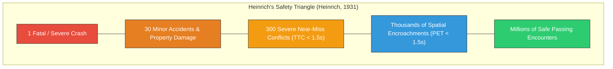
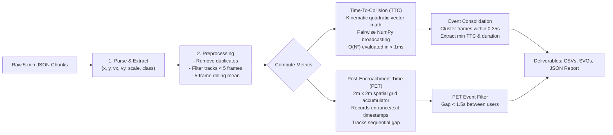

# Topic 4: Pedestrians & Cyclists at the Intersection (When and Where?)
## Complete Week 2 Project Guide: Near-Miss Safety Analysis Pipeline
*Intersection K305: Dr.-Willi-Reiland-Ring & Würzburger Str., Aschaffenburg*  
*Full 24-Hour Dataset: 2026-10-14 (288 5-Minute Files | 860,338 Frames | 11.5M Detections)*

---

## 1. Executive Summary: What Was Accomplished in Week 2

Building upon the Week 1 exploratory analysis (which verified coordinate geometries and noise thresholds), Week 2 advanced to the **core traffic safety objective of Topic 4**:
> **Detecting, quantifying, and mapping near-miss conflict events between motorized vehicles and Vulnerable Road Users (VRUs: pedestrians and cyclists).**

### 🎯 Key Milestones Delivered:
1. **Production Pipeline (`near_miss_analysis.py`)**:
   * Fully vectorised, streaming near-miss detection engine written with NumPy and Pandas.
   * Computes **Time-To-Collision (TTC)** using quadratic kinematic equations and NumPy array broadcasting.
   * Implements a streaming **Post-Encroachment Time (PET)** spatial accumulator.
   * Features CLI flags (`--quick`, `--all`, `--no-plots`, `--save-all`, `--self-test`) and automated unit self-tests for deterministic collision kinematics.
2. **Interactive Jupyter Notebook (`near_miss_analysis.ipynb`)**:
   * Interactive experimentation environment supporting both a 15-minute quick-mode and full 24-hour scans.
   * In-line SVG rendering of conflict distributions and consolidated event tables.
3. **Execution of the Full 24-Hour Scan (`output/full_day_20261026_204014_631230`)**:
   * Processed **all 288 JSON chunks** across the entire 24-hour cycle of October 14, 2026.
   * Evaluated **860,338 frames** and **11,493,486 raw object detection instances**.
   * Filtered **54,113 spurious sensor noise tracks** ($<0.5\,\text{s}$).
   * Detected and consolidated **2,583 critical TTC near-miss events** ($\text{TTC} < 1.5\,\text{s}$) involving motorized vehicles and pedestrians/cyclists.
   * Identified **22,192 PET spatial proxy events** ($\text{PET} < 1.5\,\text{s}$) within $2\,\text{m} \times 2\,\text{m}$ grid cells.

---

## 2. Theoretical Background: Why Study Near-Misses?

In classical traffic engineering, safety was historically evaluated using retrospective crash records (police accident reports). However, crashes are statistically rare events. Waiting for fatal crashes to occur at an intersection before implementing safety interventions is ethically unacceptable and statistically inefficient.



By leveraging high-frequency (10 Hz) roadside LiDAR, we apply **Surrogate Safety Measures (SSMs)**:
* **Near-misses share the exact same causal failure mechanisms as crashes** (e.g., driver inattention, blind-spot occlusions during right turns, high approach speeds, failure to yield).
* Near-misses occur **hundreds to thousands of times more frequently than crashes**, giving us statistically robust data to diagnose hazardous intersection design in just 24 hours of data.

---

## 3. The Logic Behind the Near-Miss Detection Pipeline

The pipeline implements two complementary international benchmark surrogate safety metrics: **Time-To-Collision (TTC)** and **Post-Encroachment Time (PET)**.



### 3.1 Time-To-Collision (TTC) Logic — Hayward (1972)

**Definition**: TTC is the time remaining before two road users collide if they maintain their current speeds and trajectory headings.

#### Mathematical Formulation:
Let Object 1 and Object 2 at time $t_0$ have:
* Positions: $\vec{r}_1 = (x_1, y_1)$ and $\vec{r}_2 = (x_2, y_2)$
* Velocities: $\vec{v}_1 = (v_{x1}, v_{y1})$ and $\vec{v}_2 = (v_{x2}, v_{y2})$

We define:
* **Relative Position Vector**: $\Delta \vec{r} = \vec{r}_2 - \vec{r}_1$
* **Closing Velocity Vector**: $\Delta \vec{v} = \vec{v}_1 - \vec{v}_2$

Assuming straight-line constant velocity motion, the relative position vector at future time $t$ is:
$$\vec{d}(t) = \Delta \vec{r} - \Delta \vec{v} \cdot t$$

Collision occurs when the distance between the two object centers drops to the sum of their effective protective radii $R = r_1 + r_2$:
$$\|\vec{d}(t)\|^2 = R^2$$

Expanding into component form yields a standard quadratic equation:
$$a t^2 + b t + c = 0$$

Where:
* $a = \|\Delta \vec{v}\|^2 = \Delta v_x^2 + \Delta v_y^2$ *(Relative speed squared)*
* $b = -2 (\Delta \vec{r} \cdot \Delta \vec{v}) = 2 (\Delta x \Delta v_x + \Delta y \Delta v_y)$ *(Closing convergence rate)*
* $c = \|\Delta \vec{r}\|^2 - R^2 = (\Delta x^2 + \Delta y^2) - (r_1 + r_2)^2$ *(Current surface-to-surface distance squared)*

#### Solution & Kinematic Filtering:
1. **Discriminant**: $\Delta = b^2 - 4ac$
   * If $\Delta < 0$, trajectories do not intersect in space (no collision path).
   * If $\Delta \ge 0$, real solutions exist:
     $$t_{1, 2} = \frac{-b \mp \sqrt{\Delta}}{2a}$$
2. **Physical Validity Conditions**:
   * Objects must be **approaching, not separating**: requires relative velocity $a \ge V_{\min}^2$ ($0.1\,\text{m/s}$) and convergence.
   * Objects must **not already be overlapping**: requires $c \ge 0$.
   * **Smallest Positive Root**: $\text{TTC} = \min(t_1, t_2)$ where $t > 0$.
   * **Lookahead Horizon**: $\text{TTC} \le 5.0\,\text{seconds}$.
   * **Near-Miss Threshold**: $\text{TTC} < 1.5\,\text{seconds}$ *(Standard German / international safety threshold; Minderhoud & Bovy, 2001)*.

#### Why NumPy Vectorised Broadcasting is Essential:
In daytime peak hours, a single frame can contain up to 40 detected objects. Evaluating all pairs requires:
$$\frac{N(N-1)}{2} = \frac{40 \times 39}{2} = 780 \text{ pairwise checks per frame}$$
At 10 frames per second, that equals **7,800 checks every second** (over 2.3 million checks per 5-minute file). Standard Python loops would take hours per file. By using NumPy broadcasting (`dx = xs[:, None] - xs[None, :]`), the entire $40 \times 40$ distance and velocity tensor is solved simultaneously in compiled C-level code in **less than 1 millisecond**.

---

### 3.2 Post-Encroachment Time (PET) Logic — Allen et al. (1978)

**Definition**: PET measures the time interval between the departure of the first road user from a shared conflict zone and the arrival of the second road user into that exact same conflict zone.

$$\text{PET} = t_{\text{arrival, user 2}} - t_{\text{departure, user 1}}$$

* **Key Difference from TTC**:
  * TTC is **predictive**: it evaluates whether two moving objects *would* collide if neither takes evasive action.
  * PET is **observational / post-facto**: it evaluates actual spatial clearance after the event has transpired.
  * If $\text{PET} = 0$, both objects physically occupied the exact same space simultaneously.

#### The 2-Meter Grid-Cell Spatial Proxy:
Because intersection K305 does not yet have official HD crosswalk polygons, the pipeline establishes a **uniform 2D grid-cell proxy**:
1. Space is discretized into $2.0\,\text{m} \times 2.0\,\text{m}$ grid cells:
   $$\text{cell} = \left(\left\lfloor \frac{x}{2.0} \right\rfloor, \left\lfloor \frac{y}{2.0} \right\rfloor\right)$$
2. The `PETAccumulator` logs the timestamp sequence for every track passing through each cell.
3. Timestamps within a cell are partitioned into continuous **visits** (separated if a gap $> 0.25\,\text{s}$ occurs).
4. When a motorized vehicle and a VRU visit the same cell within 10 seconds of each other:
   $$\text{PET} = \max\left(0.0,\, t_{\text{enter, 2}} - t_{\text{exit, 1}}\right)$$
5. Any event with $\text{PET} < 1.5\,\text{seconds}$ is flagged as a spatial encroachment near-miss.

---

### 3.3 Event Consolidation Logic (Frames vs. Events)

At 10 Hz recording, a pedestrian crossing a car's path over a 1.2-second window will trigger a $\text{TTC} < 1.5\,\text{s}$ warning in **12 consecutive frames**.

> [!IMPORTANT]
> **Why Raw Counting Distorts Results**:  
> If an analyst counts raw frames, one single event produces 12 near-misses, while a fleeting 0.1-second encounter produces only 1. This severely biases statistics toward slow-moving objects.

**The Solution — Event Clustering**:
* Consecutive observations for the same track pair (`track_id_1`, `track_id_2`) with time gaps $\le 0.25\,\text{s}$ are collapsed into a **single consolidated event**.
* For each event, the pipeline extracts:
  * `duration_sec`: total time the conflict condition persisted.
  * `frames_in_event`: number of continuous sensor frames.
  * `min_ttc_sec`: the most critical (lowest) TTC reached during the encounter.
  * `(x_mid, y_mid)`: the spatial coordinates where the worst TTC occurred.
  * `timestamp_local`: the exact local clock time of the peak conflict.

*Result*: Across the 24-hour dataset, **12,656 raw near-miss frames** were cleanly condensed into **2,583 distinct physical conflict events**.

---

## 4. Deep Dive into the Full-Day Output Directory

The completed 24-hour run is stored at:  
`output/full_day_20261026_204014_631230/`

Let's examine every output file, its contents, and its practical utility for the research project:

```
output/full_day_20261026_204014_631230/
├── run_report.json                    (Execution metadata, totals, and quality metrics)
├── near_miss_ttc_events.csv           (2,583 consolidated TTC near-miss events)
├── near_miss_pet_proxy_events.csv     (22,192 PET grid-cell sequential encroachments)
├── plot_ttc_consolidated_events.svg   (TTC event severity distribution histogram)
└── plot_pet_proxy_events.svg          (PET proxy temporal gap distribution histogram)
```

### 4.1 `run_report.json`
* **File Size**: 16.8 KB
* **What It Contains**: Complete provenance record of the run, including all 288 processed JSON filenames, total runtime, analyzed frames, class track breakdown, and data quality metrics.
* **Full-Day Key Figures**:
  * **Processing Runtime**: $13,528.05\,\text{s}$ ($\approx 3.75\,\text{hours}$).
  * **Frames Analysed**: $860,338$ frames ($\approx 23.9\,\text{hours}$ of continuous recording).
  * **Raw Detection Instances**: $11,493,486$ object instances.
  * **Track Distribution**:
    * Cars: $96,730$
    * Pedestrians: $46,710$
    * Cyclists: $12,770$
    * Vans: $12,907$
    * Trucks: $6,695$
    * Buses: $1,590$
    * Motorcycles: $1,432$
  * **Data Quality Cleaning Counters**:
    * Duplicate rows removed: $89$
    * Velocity outliers ($>50\,\text{m/s}$): $0$ (confirms high tracker stability)
    * Short spurious tracks ($<5$ frames) filtered: $54,113$ noise tracks.
* **How It Is Useful**: Serves as the authoritative scientific audit log. It guarantees reproducibility, verifies that no data was dropped, and provides the baseline denominators needed for traffic exposure rates.

---

### 4.2 `near_miss_ttc_events.csv`
* **File Size**: 376.9 KB | **Rows**: 2,583 consolidated events.
* **What It Contains**: The primary deliverable for Topic 4. Each row records an individual conflict encounter between a motorized vehicle and a VRU with $\text{TTC} < 1.5\,\text{s}$.
* **Key Columns**:
  * `min_ttc_sec`: Lowest TTC recorded during the interaction (seconds).
  * `duration_sec`: Duration of the conflict condition (seconds).
  * `frames_in_event`: Number of 10 Hz frames the encounter spanned.
  * `class_1`, `class_2`, `interaction_type`: Road user classifications.
  * `x_mid`, `y_mid`: Spatial coordinates (in LiDAR metric CRS) of the conflict.
  * `timestamp_local`: Local timestamp (`YYYY-MM-DDTHH:MM:SS.ffffff+02:00`).

#### Statistical Findings from the 2,583 TTC Events:
1. **Interaction Type Breakdown**:
   | Interaction Type | Event Count | Percentage | Primary Risk Context |
   | :--- | :---: | :---: | :--- |
   | **Car vs. Pedestrian** | **1,024** | **39.64%** | Crosswalk crossings vs. right/left turning vehicles. |
   | **Cyclist vs. Car** | **760** | **29.42%** | Bike lane encroachment & turning blind-spot conflicts. |
   | **Truck vs. Pedestrian** | **212** | **8.21%** | Right-turn blind spots; high severity potential. |
   | **Bus vs. Pedestrian** | **175** | **6.78%** | Transit stop approaches and wide turning arcs. |
   | **Van vs. Pedestrian** | **145** | **5.61%** | Commercial delivery traffic / turning conflicts. |
   | **Bus vs. Cyclist** | **69** | **2.67%** | Shared curb-lane overtaking and bus bay re-entry. |
   | **Truck vs. Cyclist** | **65** | **2.52%** | Lateral clearance deficits during heavy vehicle turns. |
   | **Other Motorized vs. VRU** | **133** | **5.15%** | Motorcycles and vans vs. cyclists/pedestrians. |
   | **Total** | **2,583** | **100.0%** | **Pedestrians in 61.4% | Cyclists in 38.6%** |

2. **Severity Distribution (`min_ttc_sec`)**:
   * Minimum TTC: $0.0000\,\text{s}$ (touching/grazing bounding envelopes).
   * 25th Percentile: $0.0833\,\text{s}$ (extreme close encounters).
   * **Median TTC**: **$0.5674\,\text{s}$**.
   * Mean TTC: $0.6372\,\text{s}$.
   * 75th Percentile: $1.1593\,\text{s}$.
   * Maximum TTC: $1.4996\,\text{s}$.

3. **Temporal Peak Conflict Hours**:
   * **Morning Peak (07:00 – 08:00)**: **300 events** (Peak work/school commute; highest pedestrian volume).
   * **Midday Peak (13:00 – 14:00)**: **295 events** (School dismissal and lunch hour active travel).
   * **Afternoon Peak (16:00 – 17:00)**: **286 events** (Evening commute start; heavy turning vehicle volume).
   * **Evening Peak (17:00 – 18:00)**: **212 events**.
   * *Nighttime (00:00 – 05:00)*: Near zero ($0$ to $19$ events per hour).

* **How It Is Useful**:
  * Direct input for GIS mapping and spatial clustering to highlight dangerous physical corners of K305.
  * Allows traffic planners to prioritize which turning movements (e.g. Right Turn into Würzburger Str.) require dedicated protective signal phases.
  * Provides exact timestamps so specific events can be visually inspected and replayed in 3D LiDAR viewers.

---

### 4.3 `near_miss_pet_proxy_events.csv`
* **File Size**: 2.15 MB | **Rows**: 22,192 records.
* **What It Contains**: Sequential occupancy events where a motorized vehicle and a VRU occupied the same $2\,\text{m} \times 2\,\text{m}$ grid cell within $1.5\,\text{seconds}$.
* **Key Columns**: `cell_gx`, `cell_gy`, `cell_center_x_m`, `cell_center_y_m`, `timestamp`, `track_id_1`, `track_id_2`, `pet_sec`, `interaction_type`.
* **Summary Stats**:
  * Total Events: **22,192**.
  * Median PET: **$1.0998\,\text{s}$** | Mean PET: **$0.8901\,\text{s}$**.
  * Dominant Class: `Pedestrian vs Car` ($62.5\%$) and `Car vs Pedestrian` ($13.0\%$).
* **How It Is Useful**:
  * Validates spatial overlap independently of velocity vectors.
  * Detects "tailgating" through intersections (e.g., a car accelerating through a pedestrian crosswalk immediately after a pedestrian stepped off).
  * Identifies high-friction roadway zones where vehicle paths frequently intersect pedestrian walking paths.

---

### 4.4 `plot_ttc_consolidated_events.svg`
* **File Size**: 7.3 KB | **Vector Graphic**.
* **What It Shows**: Frequency histogram of the 2,583 consolidated TTC events binned into 25 bars across the 0 to 5-second lookahead window.
* **Visual Structure**:
  * The critical near-miss zone ($0.0\,\text{s} \le \text{TTC} < 1.5\,\text{s}$) is highlighted in bold red, demarcated by a dashed threshold line at $1.5\,\text{s}$.
  * Events with $\text{TTC} \ge 1.5\,\text{s}$ are rendered in blue.
* **How It Is Useful**: Perfect visual asset for the meeting presentation slides and final poster. It visually proves that conflicts are not randomly scattered, but cluster intensely in the sub-1-second critical danger zone.

---

### 4.5 `plot_pet_proxy_events.svg`
* **File Size**: 7.3 KB | **Vector Graphic**.
* **What It Shows**: Distribution of sequential passage time gaps ($\Delta t < 1.5\,\text{s}$) within shared 2-meter grid cells.
* **How It Is Useful**: Demonstrates the frequency with which motorized vehicles enter the exact spatial footprint previously occupied by a walking or cycling citizen.

---

## 5. Critical Technical Problems & Current Limitations

To demonstrate senior data science maturity to the professor, we must openly present the known physical and algorithmic limitations of our current pipeline. Here are the 7 key challenges:

### ⚠️ Problem 1: Constant Velocity Linear Assumption in TTC
* **The Issue**: Our quadratic TTC solver assumes straight-line projection ($\vec{r}(t) = \vec{r}_0 + \vec{v} t$) with constant speed ($\vec{a} = 0$).
* **The Reality at K305**:
  1. Vehicles turning left or right follow curved trajectories (constant yaw rate, not straight lines).
  2. Vehicles approaching a crosswalk or red light are actively braking ($a < 0$).
* **The Consequence**: A car decelerating to yield to a pedestrian 10 meters away will trigger a false-positive TTC near-miss if its instantaneous approach speed is $30\,\text{km/h}$, even though the car comes to a smooth, safe stop 2 meters before the crosswalk!

### ⚠️ Problem 2: Circular Bounding Envelopes (Conservative Distortion on Large Vehicles)
* **The Issue**: To enable fast quadratic equations, vehicles are modeled as circles of radius $r = 0.5\sqrt{L^2 + W^2}$.
* **The Reality**:
  * For a standard car ($4.5\,\text{m} \times 1.8\,\text{m}$), radius is $2.4\,\text{m}$.
  * For a 12-meter Bus ($12.0\,\text{m} \times 2.55\,\text{m}$), the circumscribed radius is **$6.13\,\text{m}$** (creating a massive **$12.26\,\text{meter}$ circle**).
* **The Consequence**: If a city bus drives parallel to a cyclist in an adjacent lane with $1.5\,\text{m}$ of lateral clearance, their rectangular bodies are completely safe. However, their 6-meter circular bounding envelopes overlap, triggering a **false-positive near-miss**. This explains why Bus-vs-Pedestrian and Bus-vs-Cyclist show up heavily in our counts.

### ⚠️ Problem 3: Discretization Artifacts in the 2-Meter PET Grid Proxy
* **The Issue**: PET currently uses arbitrary $2\,\text{m} \times 2\,\text{m}$ grid squares rather than physical road lanes and crosswalk boundaries.
* **The Consequence**:
  * **Boundary Splitting**: If a car and a pedestrian pass closely across the dividing line between cell $(10, 5)$ and $(10, 6)$, the encounter is missed or divided.
  * **Diagonal Corner False Positives**: A pedestrian at the top-left corner and a car at the bottom-right corner of the same cell are $> 2.8\,\text{m}$ apart, yet registered as sharing the space.
  * **High False-Positive Volume**: The grid proxy yielded **22,192 events**, many of which occur at the curb edge where pedestrians wait on the sidewalk while cars drive past.

### ⚠️ Problem 4: Missing Traffic Signal (SPaT) & Traffic Rule Semantics
* **The Issue**: The LiDAR dataset records kinematics, but does not include Signal Phase and Timing (SPaT) logs.
* **The Consequence**:
  * The algorithm cannot distinguish between:
    * A **permitted conflict** (e.g., driver turning right on green yielding legally to a pedestrian crossing on green).
    * A **hazardous illegal violation** (e.g., driver running a red light or pedestrian jaywalking against a don't-walk signal).

### ⚠️ Problem 5: 5-Minute File Boundary Blindness
* **The Issue**: The 24-hour dataset is divided into 288 individual 5-minute JSON files.
* **The Consequence**: `run_ttc_on_chunk()` processes each file in isolation. If an interaction begins at $08:04:59.8$ and finishes at $08:05:01.2$, the event is fragmented across the file boundary. Furthermore, a track with 3 frames at the end of file 1 and 4 frames at the start of file 2 gets discarded by our short-track noise filter ($<5$ frames).

### ⚠️ Problem 6: High Computational Runtime for the Full 24-Hour Scan
* **The Issue**: Processing all 288 files took **13,528 seconds ($\approx 3.75$ hours)**.
* **The Root Cause**: While TTC frame math is vectorised in NumPy, track preprocessing relies on Pandas `df.groupby("tid")` in Python loops across tens of thousands of tracks per chunk, and `PETAccumulator` stores millions of timestamps in nested Python dictionaries.
* **Impact**: Iterative parameter tuning (e.g., testing $\text{TTC} = 1.0\,\text{s}$ vs $1.5\,\text{s}$ vs $2.0\,\text{s}$) is slow.

### ⚠️ Problem 7: Zero and Sub-10ms TTC Artifacts
* **The Issue**: In `near_miss_ttc_events.csv`, some events report `min_ttc_sec` of $0.0000$ or $0.0002\,\text{s}$.
* **The Root Cause**: This occurs when $c = \|\Delta \vec{r}\|^2 - R^2 \approx 0$ (the bounding circles are already touching upon detection). In real traffic, a TTC of 0 means a collision. In LiDAR, this is typically caused by tracking occlusions where the tracker briefly merged two bounding boxes into adjacent space.

---

## 6. Four Strategic Questions to Ask the Professor

These questions demonstrate technical depth, proactive planning, and practical solutions:

### ❓ Question 1: Traffic Signal States (SPaT) vs. Behavioral Inference
> *"Professor, we identified 2,583 consolidated TTC near-miss events across the 24 hours, with sharp peaks at 07:00, 13:00, and 16:00. However, without signal state (SPaT) logs, we cannot distinguish between permitted turning yielding maneuvers and dangerous red-light violations.*  
> *Do we have access to SPaT signal phase data for K305, or should we algorithmically infer traffic light phases from vehicle queue stop-and-go patterns at the stop bar?"*
* **Why ask**: Shows you understand the legal vs. physical dimensions of traffic safety. Inferring signal phases from queue data is an impressive data science backup plan.

### ❓ Question 2: Official Intersection Geometry (HD Map) vs. Trajectory Polygon Inference
> *"Our PET analysis currently relies on a 2m grid-cell spatial proxy, which flagged ~22k candidate encroachments—largely because curbside waiting pedestrians and passing vehicles share grid boundaries. To calculate true engineering PET, we need defined crosswalk and lane polygons.*  
> *Can we obtain an HD map or georeferenced aerial ortho-photo of K305, or should we derive crosswalk polygons directly by clustering pedestrian trajectory entry and exit points using DBSCAN?"*
* **Why ask**: Proves why PET had 22k events and offers an elegant machine learning solution (DBSCAN boundary extraction) if no digital map exists.

### ❓ Question 3: Collision Envelopes — 3D Oriented Bounding Boxes (OBB) vs. Circular Approximations
> *"Our vectorised TTC implementation currently models objects as circumscribed circles ($r = 0.5\sqrt{L^2 + W^2}$). While computationally fast, for large 12-meter buses and trucks, this creates a 12-meter circular envelope that generates false positives when passing cyclists in adjacent lanes.*  
> *Would you recommend we upgrade to Oriented Bounding Box (OBB) polygon intersection using the LiDAR yaw angle, or apply class-specific lateral safety margins?"*
* **Why ask**: Directly explains the bus/truck near-miss numbers and demonstrates advanced computational geometry knowledge (Separating Axis Theorem / OBBs).

### ❓ Question 4: Trajectory Projection — Deceleration and Turning Dynamics
> *"Currently, TTC assumes straight-line constant velocity. When vehicles approach crosswalks, they frequently decelerate to yield, which triggers false-positive low TTCs right before coming to a safe halt.*  
> *Would you recommend integrating a Constant Acceleration / Deceleration model (e.g., Deceleration to Clear), or applying a minimum velocity cutoff for vehicles approaching conflict points?"*
* **Why ask**: Highlights awareness of vehicle kinematics and shows how to refine near-miss precision for the final paper/poster.

---

## 7. Comparison: CLI Script (`near_miss_analysis.py`) vs. Notebook (`near_miss_analysis.ipynb`)

| Feature | CLI Script (`near_miss_analysis.py`) | Jupyter Notebook (`near_miss_analysis.ipynb`) |
| :--- | :--- | :--- |
| **Primary Purpose** | Automated batch pipeline, headless execution, self-testing, and reproducible full-day production runs. | Interactive research, parameter prototyping, visual data exploration, and inline SVG rendering. |
| **Execution Mode** | Run via terminal: `python near_miss_analysis.py --all` or `--files ...`. | Run cell-by-cell in VS Code / Jupyter Lab with toggles (`RUN_FULL_SCAN = True/False`). |
| **Self-Tests** | Built-in CLI flag `--self-test` verifies approaching, separating, parallel, and boundary kinematics. | Cell 12 runs the same deterministic unit tests with inline assertions. |
| **Output Directory** | Automatically writes timestamped runs to `output/<scope>_<timestamp>/`. | Writes to identical timestamped directories in `output/` with inline preview tables. |
| **Plot Generation** | Standalone SVG generation class (`SVG`) with zero external graphics dependencies. | Displays interactive SVGs directly inside the notebook outputs via `IPython.display.SVG`. |
| **Memory Profile** | Streamlined for memory efficiency during 24-hour scans. | Maintains DataFrames in memory for immediate interactive filtering and querying. |

---

## 8. Week 3 Roadmap: Next Steps & Improvements

1. **Polygon-Based Conflict Zones**: Replace the 2m PET grid proxy with true crosswalk and turning corridor polygons (using `Shapely` / `GeoPandas`).
2. **Speed & Acceleration Calibration**: Filter out yielding vehicles with negative acceleration ($a < -1.5\,\text{m/s}^2$) or speeds below $1.0\,\text{m/s}$ to eliminate deceleration false positives.
3. **OBB Geometry (Oriented Bounding Boxes)**: Implement directional collision checking using `bounding_box.yaw` to eliminate bus/truck lateral clearance artifacts.
4. **Pipeline Performance Optimization**: Refactor Pandas track-grouping into vectorized NumPy/Polars streaming windows to reduce full-day runtime from 3.75 hours to under 30 minutes.
5. **Interactive Conflict Map**: Export the 2,583 consolidated TTC events to GeoJSON / Kepler.gl / Folium for interactive 2D web visualization.
